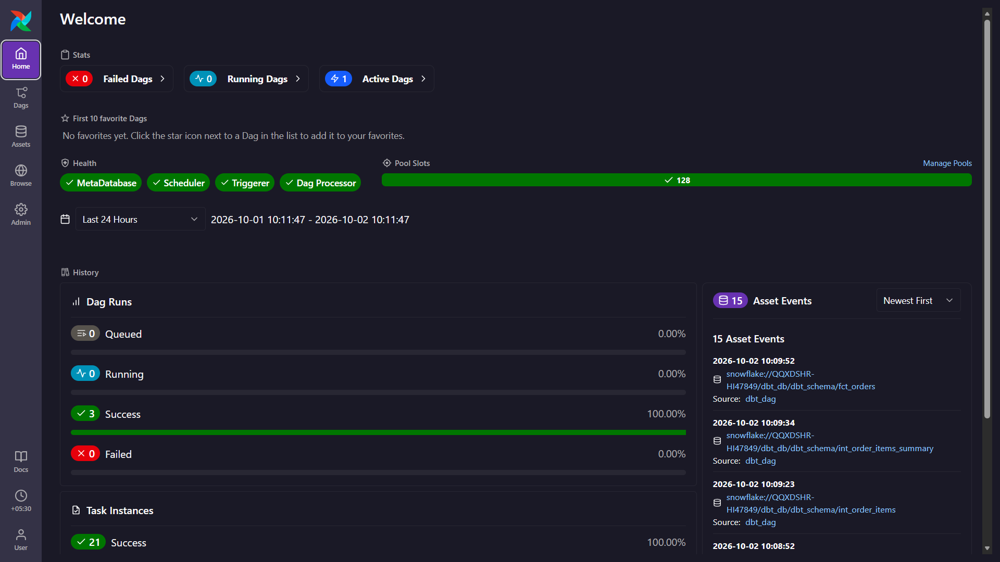
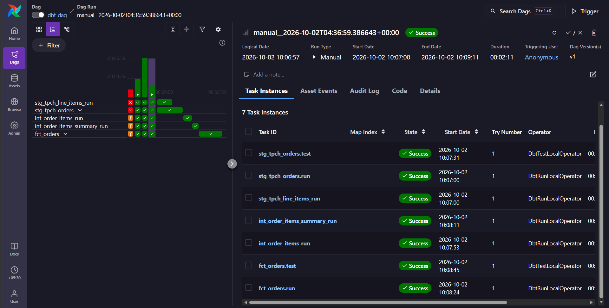
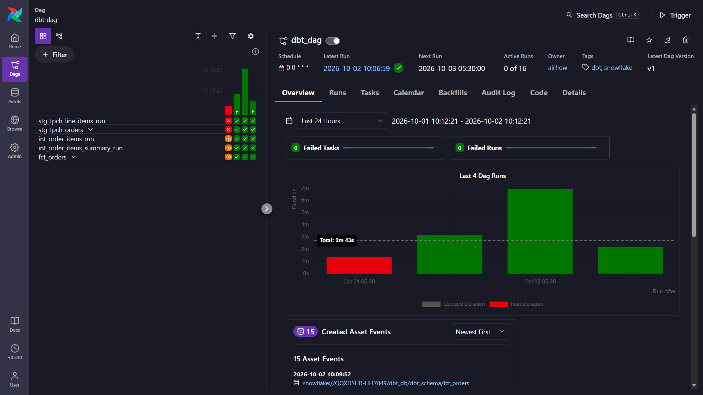
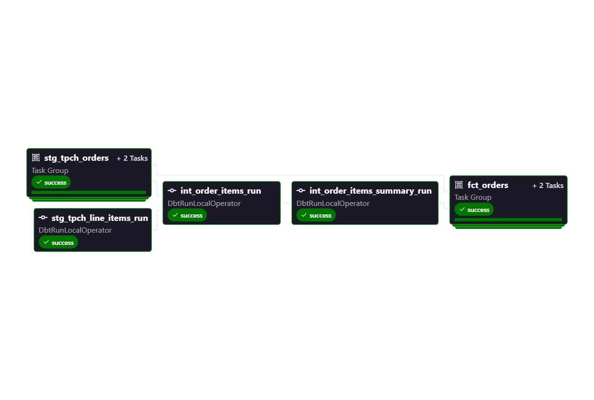

# End-to-End ELT Pipeline with dbt, Snowflake & Apache Airflow

An end-to-end ELT data engineering project that integrates **Snowflake, dbt Core, Apache Airflow, Astronomer Cosmos, Docker, and Astro CLI** to build, test, and orchestrate a modern data transformation pipeline.

The project demonstrates how data can be transformed into analytical models using dbt and then orchestrated through Airflow using Astronomer Cosmos.

## Architecture

                 ┌─────────────────┐
                 │   Source Data   │
                 └────────┬────────┘
                          │
                          ▼
                 ┌─────────────────┐
                 │    Snowflake    │
                 │   Raw / Source  │
                 └────────┬────────┘
                          │
                          ▼
                 ┌─────────────────┐
                 │     dbt Core    │
                 │  Transformations│
                 └────────┬────────┘
                          │
             ┌────────────┴────────────┐
             ▼                         ▼
      Staging Models              Mart Models
             │                         │
             └────────────┬────────────┘
                          │
                          ▼
                 ┌─────────────────┐
                 │    Snowflake    │
                 │ Analytical Data │
                 └─────────────────┘
                          ▲
                          │
                 ┌────────┴────────┐
                 │  Apache Airflow │
                 │  + Cosmos       │
                 └─────────────────┘

## Technology Stack

| Technology            | Purpose                             |
| --------------------- | ----------------------------------- |
| **Snowflake**         | Cloud data warehouse                |
| **dbt Core**          | SQL-based data transformation       |
| **Apache Airflow**    | Workflow orchestration              |
| **Astronomer Cosmos** | dbt-Airflow integration             |
| **Astro CLI**         | Local Airflow development           |
| **Docker**            | Containerized Airflow environment   |
| **Python**            | DAG configuration and orchestration |
| **SQL**               | Data transformation and modeling    |
| **Git/GitHub**        | Version control                     |

## Pipeline Workflow

The pipeline follows an ELT architecture:

1. Data is available in Snowflake.
2. dbt sources are configured to access the raw data.
3. Staging models clean and standardize the source data.
4. Intermediate transformations apply business logic.
5. Fact and dimensional models are created for analytical use.
6. dbt tests validate data quality.
7. Astronomer Cosmos integrates the dbt project with Apache Airflow.
8. Airflow orchestrates the dbt models according to their dependencies.
9. The final transformed models are materialized in Snowflake.

## Airflow Orchestration

The dbt project is orchestrated using Apache Airflow through Astronomer Cosmos.

Cosmos parses the dbt project and represents dbt models and their dependencies within the Airflow DAG, allowing the transformation workflow to be monitored and executed through the Airflow UI.

## Screenshots

### Airflow DAG Overview

The Airflow DAG orchestrates the dbt transformation workflow using Astronomer Cosmos.



_Airflow DAG overview showing the dbt pipeline configured for orchestration._

---

### Airflow Jobs

Airflow provides visibility into the individual tasks and their execution status within the pipeline.



_Airflow task execution view showing the jobs generated and executed as part of the dbt workflow._

---

### Successful Pipeline Execution

The complete dbt workflow was successfully executed through Airflow.



_Successful Airflow pipeline execution confirming that the dbt transformation workflow completed without errors._

---

### dbt DAG Graph

Astronomer Cosmos represents the dependencies between dbt models within the Airflow DAG, allowing the transformation workflow to be visualized and orchestrated.



_dbt model dependency graph generated within Airflow using Astronomer Cosmos._

## How to Run

Follow the steps below to set up and run the project locally.

### Prerequisites

Make sure the following are installed on your system:

- [Docker Desktop](https://www.docker.com/products/docker-desktop/)
- [Astro CLI](https://www.astronomer.io/docs/astro/cli/install-cli)
- [Git](https://git-scm.com/downloads)
- A Snowflake account with the required database, schema, warehouse, and user permissions

### 1. Clone the Repository

Clone this repository to your local machine:

```bash
git clone https://github.com/<your-username>/dbt-airflow-snowflake-pipeline.git
```

Navigate to the project directory:

```bash
cd dbt-airflow-snowflake-pipeline
```

### 2. Configure Snowflake Credentials

The project requires a Snowflake connection for dbt to perform the data transformations.

Configure your Snowflake credentials using the environment variables or Airflow connection configuration used by the project.

Example:

```env
SNOWFLAKE_USER=<your_username>
SNOWFLAKE_PASSWORD=<your_password>
SNOWFLAKE_ACCOUNT=<your_account>
```

Replace the placeholder values with your own Snowflake credentials.

### 3. Start Docker Desktop

Make sure Docker Desktop is installed and running before starting the Airflow environment.

### 4. Start the Astro Airflow Environment

From the project root directory, run:

```bash
astro dev start
```

### 5. Open the Airflow Web Interface

Once the Airflow environment has started successfully, open:

```text
http://localhost:8080
```

The Airflow web interface should display the DAGs configured in the project.
The DAG contains the dbt transformation workflow configured using Astronomer Cosmos.

### 7. Trigger the Pipeline

To execute the pipeline manually:

1. Open the `dbt_dag` DAG.
2. Enable the DAG if it is paused.
3. Click **Trigger DAG**.
4. Open the DAG's **Graph** or **Grid** view.
5. Monitor the individual tasks as they execute.

Airflow will orchestrate the dbt transformations according to the dependencies defined in the dbt project.

## Key Learnings

Through this project, I gained hands-on experience with:

- Building ELT pipelines using dbt Core and Snowflake
- Designing staging and analytical data models
- Implementing dbt generic and singular tests
- Creating reusable dbt macros
- Understanding Snowflake databases, schemas, warehouses, roles, and permissions
- Integrating dbt Core with Apache Airflow using Astronomer Cosmos
- Running Airflow locally using Astro CLI and Docker
- Monitoring dbt transformations through the Airflow UI
- Managing dependencies between transformation tasks
- Structuring a data engineering project for version control with Git and GitHub

## Future Improvements

Potential improvements include:

- Add CI/CD using GitHub Actions
- Add automated dbt testing
- Add production deployment for Airflow
- Implement automated data freshness checks
- Add monitoring and alerting
- Add documentation using dbt Docs
- Introduce incremental dbt models
- Add additional analytical marts
- Integrate a BI layer such as Power BI

## Credits

This project was developed as a hands-on learning implementation based on the tutorial:

**Code Along - Build an ELT Pipeline in 1 Hour (dbt, Snowflake, Airflow)**  
by Jayzern

YouTube:
https://www.youtube.com/watch?v=OLXkGB7krGo

The project was implemented and adapted locally for learning and portfolio development.
